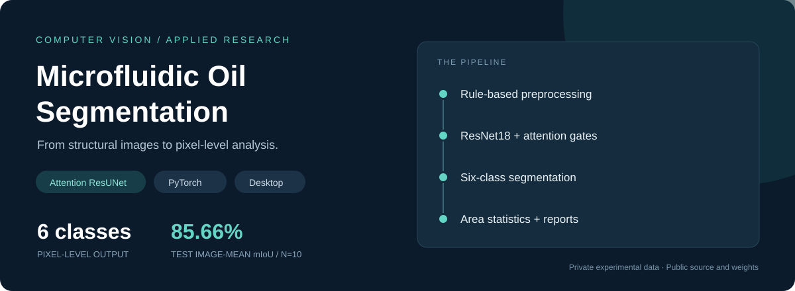
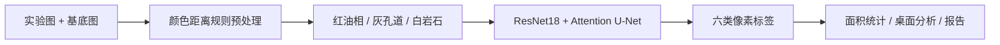

# Microfluidic Oil Segmentation

**微流控剩余油六类分割与定量分析 · Attention ResUNet · PyTorch / PyQt5**



[技术路线](docs/ARCHITECTURE.md) · [实验结果](docs/RESULTS.md) · [数据协议](docs/DATA.md) · [求职项目说明](docs/PORTFOLIO.md) · [模型权重](https://github.com/shuke-dsj/microfluidic-oil-segmentation/releases/tag/v1.0.0)

将实验室的剩余油赋存形态分析需求转为一套可操作的图像分析流程：先用颜色规则生成标准化孔隙—油相结构图，再用 Attention ResUNet 做像素级分类，最后输出各类油的面积占比、可视化和分析报告。

**本人职责：第二负责人兼技术负责人**，负责需求理解、数据清洗与预处理方案、识别模型设计和训练，以及本地推理与桌面部署。

| 六类输出 | 实验数据规模 | 测试结果 | 工具交付 |
|---|---|---|---|
| 岩石、孔道 + 四类剩余油 | 327 对训练/验证候选 + 10 对测试 | **85.66% 测试图像平均 mIoU** | 批量推理、面积 CSV、PyQt5 分析和报告 |

## 项目解决什么问题

剩余油形态与孔隙结构、边界及局部空间关系有关。仅检测油相位置无法区分非均质、孔喉、壁面和盲端四种赋存类型。本项目将其建模为六类语义分割，从像素级结果得到面积占比，为实验分析提供辅助工具。

输入中所有油相均为红色，四种类型不是通过四种输入颜色直接识别的。网络输入为三色结构图，**不是未经处理的原始显微照片**。



## 已完成的工作

- **数据流程**：清洗和整理图像/标签；颜色距离阈值预处理；RGB 标签到类别索引的转换；512×512 随机裁剪、同步翻转和颜色抖动。
- **分割模型**：ResNet18 编码器、五级 U-Net 解码器、三层 Attention Gate；Dice+CE、AdamW、余弦退火和 CUDA AMP。
- **推理与分析**：动态 padding 到 32 的倍数并恢复原尺寸；单图/批量预测；类别索引图、彩色图、各类面积和油类内部相对占比。
- **本地部署**：PyQt5 桌面交互，支持导入模型、图像和可选真值标签，完成单图、批处理和离线报告；另保留预处理 GUI。
- **实验核验与工程整理**：逐图/全局双 mIoU、逐类 IoU、混淆矩阵、注意力门控诊断；共享模型定义、CLI、数据配对校验、训练配置/划分保存及自动化测试。

## 关键结果

| 指标 | 结果 | 解释 |
|---|---:|---|
| 历史最佳验证 mIoU | **98.36%** | 既有 50 轮训练日志；随机图像划分的 66 图验证集 |
| 本次测试图像平均 mIoU | **85.66%** | 发布权重在 10 图私有测试集上的 FP32 复核 |
| 本次测试全局 mIoU | **85.68%** | 累积全部测试像素混淆矩阵计算 |
| 非均质 / 孔喉 / 壁面油 IoU | 99.09% / 90.14% / 91.47% | 全局逐类指标 |
| 盲端油 IoU | **34.30%** | 主要短板；测试真值仅 5,240 像素 |

验证指标与测试指标分开呈现。当前没有同配置重训练消融；不宣称相对 U-Net 的提升幅度。更完整的指标口径、局限和原始数值见 [实验结果](docs/RESULTS.md) 与 [复核 JSON](reports/reproduced/evaluation.json)。

## 展示：合成输入与桌面应用

下图为**几何规则生成的合成输入**，只演示输入格式与运行链路，不含实验图像，也不用于精度评测。


桌面端展示见 [使用说明](docs/USAGE.md)。实验图像、标签和含实验图像的结果图不公开；模型权重通过 Release 提供。

## 快速开始

建议 Python 3.11。PyTorch 与 torchvision 需安装匹配版本；本次验证环境为 `torch==2.3.1 / torchvision==0.18.1`，完整版本见 [requirements-tested.txt](requirements-tested.txt)。

```bash
git clone https://github.com/shuke-dsj/microfluidic-oil-segmentation.git
cd microfluidic-oil-segmentation
python -m venv .venv
# Windows PowerShell: .venv\Scripts\Activate.ps1
# Linux/macOS: source .venv/bin/activate
python -m pip install ".[desktop,analysis,dev]"
python tools/download_weights.py
oilseg predict --images examples/synthetic_input.png --weights weights/attention_resunet.pth --output outputs/demo --device cpu
```

输出 `*_mask.png`（像素值 0–5）、`*_color.png`、`*_areas.csv`。没有 CUDA 也能运行 CPU 推理。完整实验数据未公开，因此这个快速示例只验证推理链路。

桌面工具：

```bash
python apps/desktop.py
python tools/preprocess_gui.py
```

训练与评估（需自行准备符合协议且有权使用的数据）：

```bash
oilseg train --images data/train/images --masks data/train/masks --output outputs/train --epochs 50 --batch-size 8
oilseg evaluate --images data/test/images --masks data/test/masks --weights weights/attention_resunet.pth --output outputs/eval
python -m pytest -q
```

新训练默认随机 80/20 划分，可用 `--split` 提供按芯片/实验批次分组的划分；默认会下载 ImageNet 编码器权重，可用 `--no-pretrained` 禁用。新训练产物不应与仓库中的历史实验结果混淆。

## 仓库结构

```text
src/oilseg/        统一模型、标签协议、数据、训练、推理、指标与 CLI
apps/desktop.py   PyQt5 桌面分析应用
tools/            预处理 GUI、注意力分析、合成示例与权重下载
docs/             技术路线、数据协议、实验结果、使用和求职说明
reports/          历史指标与本次复核结果（仅数值，不含实验图像）
examples/         可公开的合成示例
weights/          权重说明；checkpoint 从 Release 下载
tests/            数据协议、指标、尺寸恢复、模型梯度等测试
.github/          CPU 自动化检查配置
```

## 已知限制与下一步

数据量小、随机图像划分可能受相关帧影响，需补充分组验证；盲端类极少，需补样及采样优化；注意力诊断不等价于正式消融。当前部署是本地桌面工具，未验证生产服务能力。详见 [技术路线](docs/ARCHITECTURE.md) 和 [实验结果](docs/RESULTS.md)。

代码与权重公开供项目展示和研究交流。仓库暂未授予开源许可证；如需再分发、商用或训练用途授权，请联系仓库作者。实验数据及标签保持私有。
