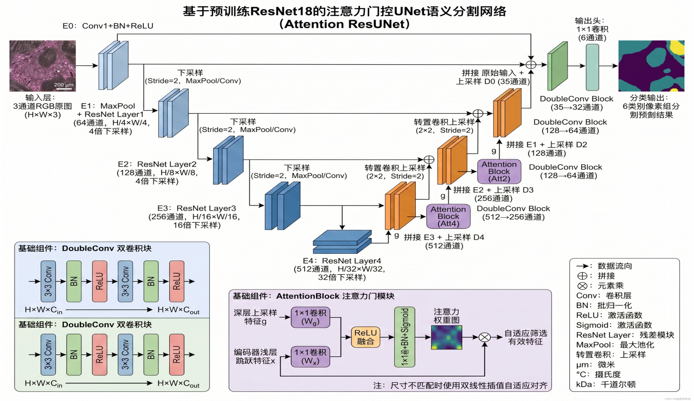
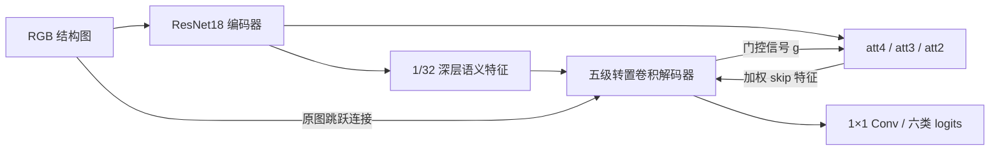

# 技术路线

## 从实验需求到可交付工具

1. **需求建模**：将剩余油形态判别转为像素级六分类，支持区域面积统计，而非只判断是否存在油。
2. **数据清洗与规则预处理**：识别基底的近红/近白主导色；利用 RGB 欧氏距离阈值构造岩石和孔道底图，再叠加实验图中的油相，得到三色结构图。`tools/preprocess_gui.py` 支持阈值调整、预览和批量保存，要求基底与实验图尺寸匹配。
3. **监督分割**：彩色标签转类别索引；512×512 随机裁剪、同步翻转和图像颜色抖动；六类输出。
4. **训练优化**：Dice 与 Cross Entropy 各占 0.5，AdamW、余弦退火、CUDA AMP；按验证集图像平均 mIoU 保存最佳权重。
5. **原尺寸推理**：右侧和底部 pad 到 32 的倍数，推理后精确裁回原尺寸，避免统一缩放改变细小形态。极小图像采用 replicate padding 防止 reflect 越界。
6. **工具交付**：命令行单图/批量推理、类别索引图/彩色图/面积 CSV；PyQt5 桌面单图、GT 对比、批量分析与离线报告；注意力门控诊断。

## 模型结构

图中输入缩略图为示意；实际输入是规则预处理后的三色结构图。具体通道与尺寸以代码为准。

编码器通道为 64、64、128、256、512；三个注意力门作用于较深的三条 skip 连接，最浅的特征连接和原图连接直接拼接。门控通过 `ReLU(Wg(g)+Wx(x))`、1×1 卷积、BN 和 Sigmoid 产生单通道空间权重 α，然后计算 `x * α`。它是类别无关的特征门控，不能把 α 当作油概率。

训练时可初始化 ImageNet ResNet18；加载公开 checkpoint 时默认 `pretrained=False`，不触发额外网络下载。沿用既有训练的 `[0,1]` 输入处理，不在推理时擅自添加 ImageNet 均值/方差标准化。

## 工程整理改动

| 原有问题 | 本次处理 |
|---|---|
| 训练、预测、桌面端重复模型定义 | 统一到 `src/oilseg/model.py` |
| 预测路径绑定个人电脑、推理会创建目录 | 使用 CLI 参数与显式输出路径 |
| 图像和掩码仅按排序配对 | 检查同名、数量、尺寸，遇错退出 |
| 标签未知颜色静默归到背景 | 共享标签协议并明确报错 |
| 推理按 16/32 倍数处理不统一 | 统一 32 倍数，保留原尺寸 |
| CPU 路径仍强行开启 CUDA autocast | 按运行设备开启 CUDA AMP |
| 训练配置和划分未持久保存 | 每次写入 config、split 和逐 epoch CSV |
| 聚合指标容易混用 | 同时导出逐图平均与全局混淆矩阵 mIoU |
| 调试文件、权重、数据混杂 | 独立发布目录，数据忽略，权重走 Release |

这些是可复用性和可核验性的改进；没有重新训练模型，也没有据此宣称精度提升。

## 部署范围

已实现本地 PyTorch 推理和 PyQt5 桌面应用。当前桌面推理及批处理仍在界面线程执行，大图或长批次可能阻塞界面。未实现或验证 Web 服务、Docker、ONNX/TensorRT、异步任务队列及生产监控，不把它们列作已完成成果。
