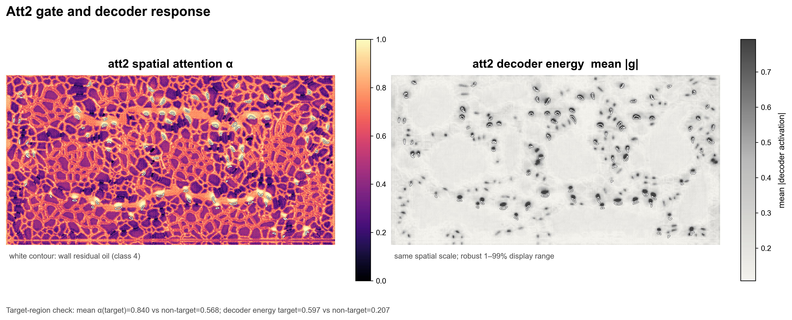

# 实验结果与证据边界

## 结果一览

| 指标 | 结果 | 来源与口径 |
|---|---:|---|
| 历史最佳验证 mIoU | 98.3642% | `reports/historical/training_metrics.csv`，epoch 50；图像内有效类别平均，再对验证图平均 |
| 本次测试图像平均 mIoU | 92.6628% | `reports/reproduced/evaluation.json`；10 图、FP32、CUDA |
| 本次测试全局 mIoU | 92.6825% | 累加所有测试像素的混淆矩阵后计算六类 IoU 均值 |
| 本次测试像素准确率 | 99.6691% | 混淆矩阵对角线像素数 / 全部像素数 |
| 历史门控诊断正常推理 mIoU | 92.6628% | 历史逐图 CSV 的均值，与本次 FP32 复核结果一致 |

## 本次逐类表现

| 类别 | 全局 IoU | 测试真值像素数 |
|---|---:|---:|
| 岩石 | 99.7148% | 14,771,770 |
| 孔道 | 99.3811% | 5,894,556 |
| 非均质剩余油 | 99.0909% | 3,246,316 |
| 孔喉剩余油 | 90.1371% | 270,694 |
| 壁面剩余油 | 91.4737% | 181,264 |
| 盲端剩余油 | 80.2972% | 5,240 |

高像素准确率受到岩石和孔道等大区域主导，不能替代少数类指标。盲端剩余油仅占测试像素约 0.0215%，明显拖低宏平均 IoU。改进方向应优先关注少数类补样、采样策略和跨实验划分。

## mIoU 的两种聚合方式

`image_mean_miou`：每张图先计算类别 IoU，排除预测和真值都不存在的类别，再取图像平均；最后对所有图像平均。历史训练使用这一类口径。

`global_miou`：先在全测试集上累加混淆矩阵，再计算每类 IoU 和类别均值。它与逐图平均不是同一统计量。

代码和报告同时保留这两个数，避免混用。逐图指标位于 `reports/reproduced/per_image.csv`，全局混淆矩阵与权重 SHA-256 位于 `evaluation.json`。

## Attention Gate 诊断

该图展示按壁面油区域 α 对比度选择的单张样本：白色轮廓为壁面油区域，左侧为 att2 空间门控系数，右侧为解码器平均绝对激活。该样本的对比不代表所有测试图的平均表现，也不能作为正式消融实验。

历史分析使用 `att4`、`att3`、`att2` 的 α 图、skip 特征平均绝对能量和 10 图数值统计：

| Gate | mean α(oil) | mean α(non-oil) | top-10% oil enrichment |
|---|---:|---:|---:|
| att4 | 0.6904 | 0.6060 | 1.8623 |
| att3 | 0.3446 | 0.5317 | 0.6877 |
| att2 | 0.6259 | 0.5639 | 0.7975 |

不是每层都优先强调油区。空间门控会保留有用边界或其他非油特征。

历史推理时强制三个 Gate 的 α=1，10 图平均 mIoU 从约 85.66% 变为 58.01%。这说明既有模型依赖训练形成的门控特征分布；原始数值保存在 `reports/historical/attention_gate_alpha_one_intervention.csv`。

## 复核环境与局限

- 日期：2026-11-17；PyTorch 2.3.1、torchvision 0.18.1；NVIDIA GeForce RTX 4050 Laptop GPU。
- 发布权重：`resunet_output/best_resunet.pth`，重命名为 `attention_resunet.pth`；没有将根目录另一个同名用途的 checkpoint 混入结果。
- 本次使用 FP32，历史环境与硬件未完整记录，允许末位浮点数差异；不承诺不同硬件上结果逐位相同。
- 只有 10 张测试图，不支持“跨设备稳定泛化”“达到工业级水平”等结论。
- 没有同配置重新训练的 U-Net / ResUNet / 无注意力基线，未证实架构带来的净收益。
- 未保存芯片/视频批次元数据；未来应采用按实验分组的验证方案。
- 实验数据不公开，外部用户无法仅凭本仓库复现私有测试指标。
